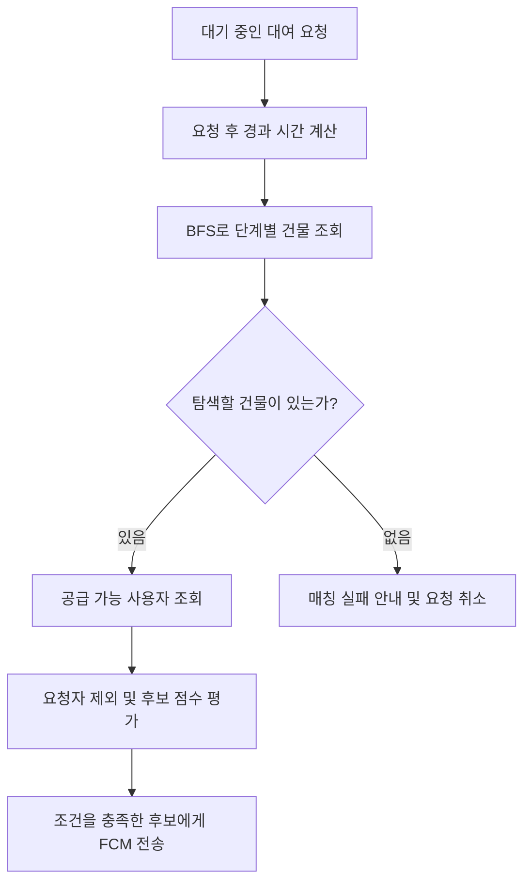
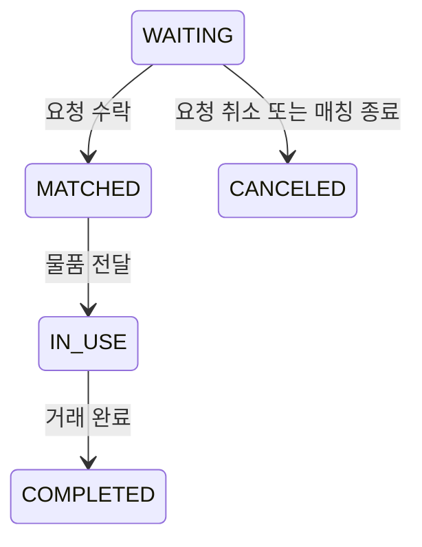

<div align="center">

  

  <h1>빌릿 · Villit</h1>

  <p><strong>캠퍼스 안에서, 필요한 물건을 가까운 사람에게.</strong></p>
  <p>위치 기반 교내 물품 대여 매칭 서비스의 Spring Boot 백엔드</p>

  
  
  
  
  

  <br><br>

  <a href="https://github.com/com0ze/Villit_Backend/tree/develop">백엔드 소스</a> ·
  <a href="https://github.com/com0ze/Villit_Frontend/tree/feature/update">프론트엔드 저장소</a>

</div>

<br>

[프로젝트 소개](#프로젝트-소개) · [주요 기능](#주요-기능) · [핵심 구현](#핵심-구현) · [기술 스택](#기술-스택) · [주요 API](#주요-api) · [실행 방법](#실행-방법) · [프로젝트 구조](#프로젝트-구조)

## 프로젝트 소개

**Villit**은 동국대학교 캠퍼스에서 급하게 물품이 필요한 학생과 가까운 공급자를 연결하는 대여 매칭 서비스입니다. 요청 등록부터 상대방과의 채팅, 물품 전달·반납, 후기 작성까지 하나의 서비스에서 이어집니다.

백엔드는 **사용자 인증**, **대여 요청과 거래 상태 관리**, **건물 간 인접 관계를 이용한 매칭**, **실시간 채팅과 푸시 알림**을 담당합니다.

| 항목 | 내용 |
| :--- | :--- |
| 개발 기간 | 2026.03 – 2026.06 |
| 프로젝트 | 동국대학교 공개SW프로젝트 · 4인 팀 프로젝트 |
| 서버 | Java 21 · Spring Boot 3.3.4 |
| 데이터베이스 | MySQL · Spring Data JPA |
| 구현 기준 | [`develop`](https://github.com/com0ze/Villit_Backend/tree/develop) 브랜치 |

## 주요 기능

| 기능 | 설명 |
| :--- | :--- |
| **회원가입·로그인** | 이메일·비밀번호 기반 인증, BCrypt 비밀번호 해싱, JWT 발급 |
| **토큰 재발급** | Refresh Token 검증과 저장된 사용자 정보 확인 후 Access Token 재발급 |
| **위치·공급 상태 관리** | 현재 건물, 공급 가능 상태, FCM 기기 토큰 갱신 |
| **대여 요청 관리** | 요청 생성·목록·상세 조회, 요청 수락·취소, 물품 전달·거래 완료 처리 |
| **단계별 매칭** | 건물 인접 그래프를 BFS로 탐색하고 경과 시간에 따라 알림 대상 범위 확장 |
| **후보 점수 산정** | 매너 점수, 최근 활동, 동일 물품 공급 이력을 반영해 알림 대상 선별 |
| **실시간 채팅** | 채팅방 생성·조회, STOMP 메시지 송수신, 대화 내역 저장·조회 |
| **푸시 알림** | 대여 요청 및 매칭 실패 안내를 FCM으로 전송 |
| **후기·프로필** | 거래 후기 작성, 사용자 프로필과 받은 후기 조회 |
| **주기적 정리** | 대기 요청 매칭, 장기 미활동 사용자의 공급 상태 정리, 오래된 요청 취소 |

## 핵심 구현

### 1. BFS 기반 단계별 매칭

캠퍼스의 건물을 노드로, 인접한 건물 사이의 연결을 간선으로 표현했습니다. 요청이 발생한 건물에서 **BFS로 연결 단계를 계산**하고, 요청 후 경과 시간에 따라 탐색 대상을 바꿉니다.

- 요청 후 `n`분이 지나면 일반 후보는 **거리 `n`**, 더 높은 점수 기준을 적용하는 후보는 **거리 `n + 1`**의 건물에서 조회합니다.
- 공급 가능 상태이며 FCM 토큰이 등록된 사용자 중 요청자 본인을 제외합니다.
- 후보별 점수를 계산해 기준을 충족한 사용자에게 대여 요청 알림을 전송합니다.
- 해당 단계에서 탐색할 건물이 더 이상 없으면 요청자에게 매칭 실패를 안내하고 요청을 취소 상태로 변경합니다.

여기서 거리는 실제 미터 단위가 아닌 **건물 인접 그래프상의 최단 연결 단계**입니다.



매칭 작업은 `MatchingScheduler`에서 **매분 실행**하며, `WAITING` 상태인 요청을 대상으로 처리합니다.

### 2. 사용자 특성을 반영한 후보 점수

후보 점수는 다음 세 항목을 가중 합산합니다.

| 평가 항목 | 비중 | 반영 내용 |
| :--- | :---: | :--- |
| **매너 점수** | 50% | 사용자 평점을 환산해 반영 |
| **최근 활동** | 30% | 마지막 활동 후 경과 시간에 따라 점수 감소 |
| **동일 물품 공급 이력** | 20% | 요청 물품을 이전에 공급한 이력이 있는지 확인 |

```text
후보 점수 = 매너 점수 × 0.5
          + 최근 활동 점수 × 0.3
          + 동일 물품 공급 이력 점수 × 0.2
```

가입 후 24시간 이내이면서 공급 이력이 3회 미만인 사용자는 신규 사용자 조건을 적용해, 점수 기준 때문에 초기 참여가 제한되지 않도록 구성했습니다.

### 3. 위치 감지와 서버 처리를 분리

프론트엔드는 GeoJSON 건물 경계를 기준으로 현재 건물을 판별하고, 건물 전환이 확정되면 위치 갱신 API를 호출합니다.

백엔드는 전달받은 **현재 건물 코드**를 사용자 정보에 반영하고, 이를 주변 요청 조회와 매칭 후보 검색에 사용합니다.

```text
기기에서 GPS 수신·건물 판별
          ↓
건물 전환 확정
          ↓
PATCH /api/v1/users/location
          ↓
사용자 현재 건물 갱신
          ↓
주변 요청 조회·매칭 후보 검색에 활용
```

GPS 좌표마다 서버에 요청하는 방식 대신, **건물 변경 중심의 위치 갱신 구조**를 사용합니다.

### 4. 거래 상태에 따른 처리

대여 요청의 진행 상태는 `RequestStatus`로 관리합니다.



요청 수락 시 현재 상태를 확인하고, 대기 중인 요청이 아닌 경우 수락을 제한합니다. 요청 생성 시에는 동일 사용자의 대기 요청 존재 여부를 검사합니다.

요청·매칭 이력·사용자 등의 데이터는 JPA 엔티티로 관리하고, 상태 변경을 수행하는 서비스 메서드에 트랜잭션을 적용했습니다.

### 5. JWT 인증과 채팅·알림

- Spring Security의 JWT 인증 필터로 API 요청을 처리합니다.
- 비밀번호는 BCrypt로 해싱하고, 로그인 시 Access Token과 Refresh Token을 발급합니다.
- Refresh Token은 사용자 정보에 저장하며, 재발급 요청에서 토큰 유효성과 저장된 토큰을 확인합니다.
- 채팅은 WebSocket·STOMP로 처리하고 대화 내역을 데이터베이스에 저장합니다.
- FCM 메시지에 요청 ID와 알림 유형을 포함해, 클라이언트가 관련 화면으로 연결할 수 있도록 구성했습니다.

## 기술 스택

| 영역 | 기술 | 용도 |
| :--- | :--- | :--- |
| 언어 | **Java 21** | 서버 애플리케이션 개발 |
| 프레임워크 | **Spring Boot 3.3.4 · Spring Web** | REST API 및 애플리케이션 구성 |
| 인증 | **Spring Security · JJWT · BCrypt** | JWT 인증, 토큰 발급·검증, 비밀번호 해싱 |
| 데이터 접근 | **Spring Data JPA · Hibernate** | 엔티티 매핑 및 데이터 조회·변경 |
| 데이터베이스 | **MySQL** | 사용자·요청·매칭·채팅·후기 저장 |
| 실시간 통신 | **Spring WebSocket · STOMP** | 채팅방 구독 및 메시지 송수신 |
| 알림 | **Firebase Admin SDK · FCM** | 기기별 푸시 알림 전송 |
| 주기적 처리 | **Spring Scheduling · Async** | 대기 요청 매칭 및 정리 작업 |
| 빌드 | **Gradle Wrapper 8.8** | 의존성 관리 및 빌드 |

## 주요 API

인증이 필요한 HTTP 요청에는 다음 헤더를 사용합니다.

```http
Authorization: Bearer <ACCESS_TOKEN>
```

### 인증·사용자

| Method | Endpoint | 설명 |
| :---: | :--- | :--- |
| POST | `/api/v1/auth/signup` | 회원가입 |
| POST | `/api/v1/auth/login` | 로그인 및 토큰 발급 |
| POST | `/api/v1/auth/refresh` | Access Token 재발급 |
| GET | `/api/v1/users/me` | 내 프로필 조회 |
| GET | `/api/v1/users/{userId}` | 다른 사용자 프로필 조회 |
| PATCH | `/api/v1/users/location` | 현재 건물 갱신 |
| PATCH | `/api/v1/users/me/duty` | 공급 가능 상태 변경 |
| PATCH | `/api/v1/users/me/device-token` | FCM 기기 토큰 갱신 |

### 대여·후기

| Method | Endpoint | 설명 |
| :---: | :--- | :--- |
| POST | `/api/v1/requests` | 대여 요청 생성 |
| GET | `/api/v1/requests` | 대여 요청 목록 조회 |
| GET | `/api/v1/requests/nearby` | 주변 대여 요청 조회 |
| GET | `/api/v1/requests/me` | 내 요청·거래 목록 조회 |
| GET | `/api/v1/requests/{requestId}` | 요청 상세 조회 |
| POST | `/api/v1/requests/{requestId}/accept` | 대여 요청 수락 |
| PATCH | `/api/v1/requests/{requestId}/cancel` | 요청 취소 |
| PATCH | `/api/v1/requests/{requestId}/handover` | 물품 전달 처리 |
| PATCH | `/api/v1/requests/{requestId}/complete` | 거래 완료 처리 |
| POST | `/api/v1/reviews` | 후기 작성 |
| GET | `/api/v1/users/{userId}/reviews` | 사용자가 받은 후기 조회 |

### 채팅

| 구분 | 경로 | 설명 |
| :--- | :--- | :--- |
| POST | `/api/v1/chats` | 채팅방 생성 |
| GET | `/api/v1/chats` | 내 채팅방 목록 조회 |
| GET | `/api/v1/chats/{roomId}/messages` | 대화 내역 조회 |
| WebSocket | `/ws-stomp` | STOMP 연결 |
| SEND | `/app/chat.send` | 채팅 메시지 전송 |
| SUBSCRIBE | `/topic/rooms/{roomId}` | 채팅방 메시지 구독 |

STOMP 연결 시 `Authorization` 헤더에 Bearer 토큰을 전달합니다.

### 대여 요청 예시

```http
POST /api/v1/requests
Authorization: Bearer <ACCESS_TOKEN>
Content-Type: application/json
```

```json
{
  "itemName": "충전기",
  "buildingName": "INFO_CULTURE",
  "rewardAmt": 1000,
  "duration": 60,
  "memo": "한 시간 동안 사용하고 반납하겠습니다."
}
```

`duration`의 단위는 분입니다. 건물명은 프론트엔드와 백엔드에서 사용하는 건물 코드에 맞춰 전달합니다.

토큰 재발급 요청의 본문 필드명은 `refreshToken`입니다.

```json
{
  "refreshToken": "<REFRESH_TOKEN>"
}
```

## 실행 방법

### 1. 개발 환경 준비

- JDK 21
- MySQL
- Firebase 프로젝트 및 FCM 발송 권한이 있는 서비스 계정
- Gradle Wrapper 사용 — 별도 Gradle 설치 불필요

### 2. 구현 브랜치 받기

```bash
git clone --branch develop https://github.com/com0ze/Villit_Backend.git
cd Villit_Backend
```

### 3. 로컬 데이터베이스 준비

```sql
CREATE DATABASE villit
  CHARACTER SET utf8mb4
  COLLATE utf8mb4_unicode_ci;
```

### 4. 로컬 실행 설정

다음은 **로컬 개발용 설정 예시**입니다. 실행 환경에 맞게 `src/main/resources/application-local.yml`을 추가합니다.

```yaml
spring:
  datasource:
    url: ${DB_URL:jdbc:mysql://localhost:3306/villit}
    username: ${DB_USERNAME}
    password: ${DB_PASSWORD}
    driver-class-name: com.mysql.cj.jdbc.Driver

  jpa:
    hibernate:
      ddl-auto: update
    show-sql: false

jwt:
  secret: ${JWT_SECRET}
  access-token-validity-in-seconds: 3600
  refresh-token-validity-in-seconds: 604800

server:
  port: 8080
```

| 환경변수 | 내용 |
| :--- | :--- |
| `DB_URL` | MySQL 접속 URL · 예시의 기본값은 로컬 `villit` DB |
| `DB_USERNAME` | 데이터베이스 사용자 |
| `DB_PASSWORD` | 데이터베이스 비밀번호 |
| `JWT_SECRET` | Base64로 인코딩한 32바이트 이상의 무작위 서명 키 |

토큰 유효기간 값은 로컬 실행 예시이며 단위는 초입니다. 실제 비밀번호와 서명 키는 공개 저장소에 작성하지 않고 실행 환경에서 설정합니다.

프로필별 설정과 환경변수 사용은 [Spring Boot 외부 설정 안내](https://docs.spring.io/spring-boot/3.3/reference/features/external-config.html)를 참고할 수 있습니다.

### 5. Firebase 설정

현재 `FcmConfig`는 다음 클래스패스 파일을 읽어 Firebase를 초기화하도록 작성되어 있습니다.

```text
src/main/resources/firebase-service-key.json
```

연결할 Firebase 프로젝트의 서비스 계정 파일을 해당 경로에 준비합니다. 프론트엔드에서 발급한 FCM 기기 토큰도 같은 Firebase 프로젝트와 연결되어 있어야 합니다.

서비스 계정 JSON에는 비공개 키가 포함되므로 저장소에 커밋하지 않습니다.

### 6. 서버 실행

환경변수를 설정한 뒤 `local` 프로필로 실행합니다.

**Windows PowerShell**

```powershell
.\gradlew.bat bootRun --args="--spring.profiles.active=local"
```

**macOS / Linux**

```bash
./gradlew bootRun --args='--spring.profiles.active=local'
```

위 설정 예시의 HTTP 서버 주소는 `http://localhost:8080`, WebSocket 주소는 `ws://localhost:8080/ws-stomp`입니다.

프론트엔드의 API·토큰 갱신·WebSocket 주소를 실행한 서버에 맞게 설정합니다. 모바일 실기기에서는 기기에서 접근 가능한 서버 주소를 사용해야 합니다.

### 7. 빌드·테스트

**Windows**

```powershell
.\gradlew.bat build
.\gradlew.bat test
```

**macOS / Linux**

```bash
./gradlew build
./gradlew test
```

<details>
<summary><strong>실행 및 테스트 설정 참고</strong></summary>

- 저장소의 구현 코드는 `develop` 브랜치를 기준으로 확인할 수 있습니다.
- 현재 테스트 설정 파일은 `src/test/java/com/example/OSSP_BackEnd/resources/application-test.yml`에 있습니다. 기본 Gradle 구조에서 테스트 리소스로 읽히도록 하려면 `src/test/resources/application-test.yml`로 옮기고 테스트용 DB 설정을 준비해야 합니다.
- 기존 설정 파일에 직접 작성된 JWT 키가 있으므로, 실제 실행 환경에서는 위 예시처럼 별도 키를 설정하는 것이 좋습니다. 공개된 키를 서비스에서 사용했다면 교체해야 합니다.
- Firebase 초기화와 기기 토큰 등록이 준비되어야 실제 푸시 알림 동작을 확인할 수 있습니다.
- 위 명령은 실행 절차이며, 전체 테스트 통과나 실제 배포 환경의 동작 검증 완료를 의미하지 않습니다.

</details>

## 프로젝트 구조

```text
src/main/java/com/example/OSSP_BackEnd/
├── config/       # Security · JWT · WebSocket · Firebase 설정
├── controller/   # 인증 · 사용자 · 요청 · 채팅 · 후기 API
├── dto/          # API 요청·응답 객체
├── entity/       # 사용자 · 요청 · 매칭 · 채팅 · 후기 엔티티
├── exception/    # 예외 정의 및 공통 예외 처리
├── repository/   # JPA 저장소와 조회 쿼리
├── scheduler/    # 주기적 매칭 및 대기 요청 정리
├── security/     # 인증 사용자 정보
├── service/      # 거래 · 매칭 · 점수 계산 · 채팅 · 알림 로직
└── OsspBackEndApplication.java

src/main/resources/
├── application.yml
└── static/       # 정적 테스트 페이지

docs/
├── MATCHING_ALGORITHM_README.md
├── api_specification.txt
└── tree.md
```

로컬 실행 설정과 Firebase 서비스 계정 파일은 각자의 실행 환경에 맞게 별도로 준비합니다.

## 관련 문서 · 라이선스

- [매칭 알고리즘 설명](https://github.com/com0ze/Villit_Backend/blob/develop/docs/MATCHING_ALGORITHM_README.md)
- [API 명세](https://github.com/com0ze/Villit_Backend/blob/develop/docs/api_specification.txt)
- [Villit Frontend](https://github.com/com0ze/Villit_Frontend/tree/feature/update)
- 본 프로젝트는 [MIT License](LICENSE)를 따릅니다.
